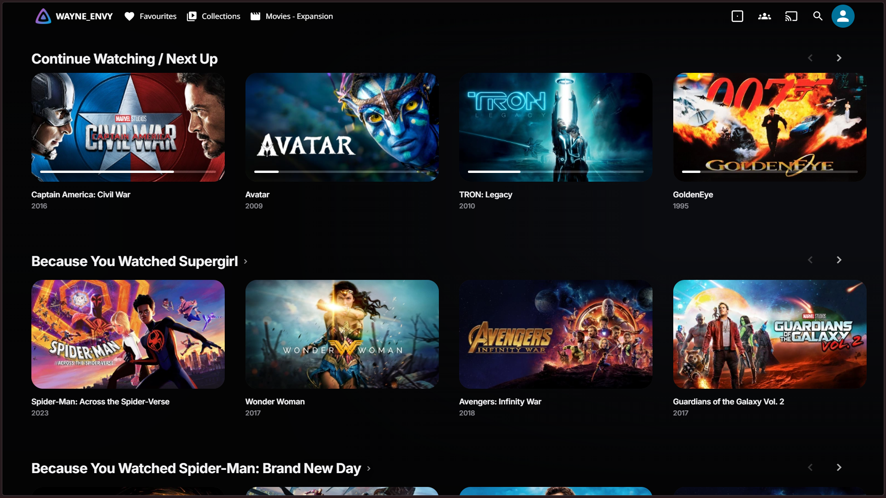
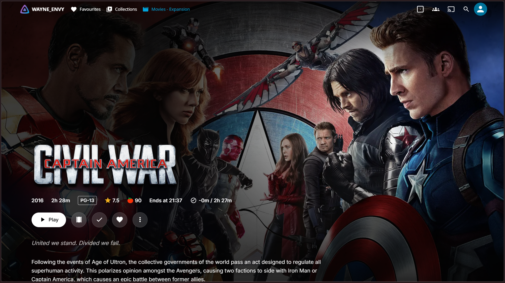
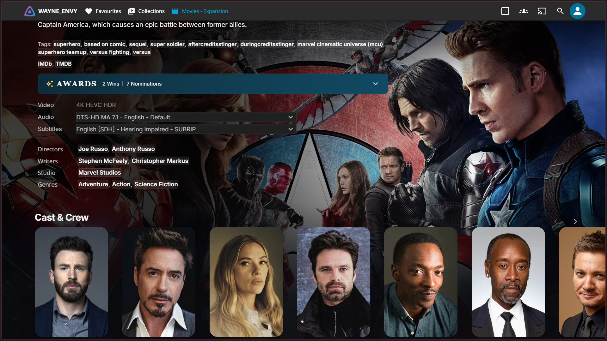

# Ezflix

Modern, responsive theme for Jellyfin.

## Note

This theme is written for Jellyfin 12.1, with these custom plugins installed:

- Home Screen Sections (https://github.com/IAmParadox27/jellyfin-plugin-home-sections)
- File Transformation (https://github.com/IAmParadox27/jellyfin-plugin-file-transformation)
- Plugin Pages (https://github.com/IAmParadox27/jellyfin-plugin-pages)
- Jellyfin Enhanced (https://github.com/n00bcodr/Jellyfin-Enhanced)

## Installation

add on custom css
```css
@import url('https://cdn.jsdelivr.net/gh/Sai-Raveendra-Kandregula/ezflix-jf-theme@main/ezflix/theme.css');
```

## Previews

### Desktop





